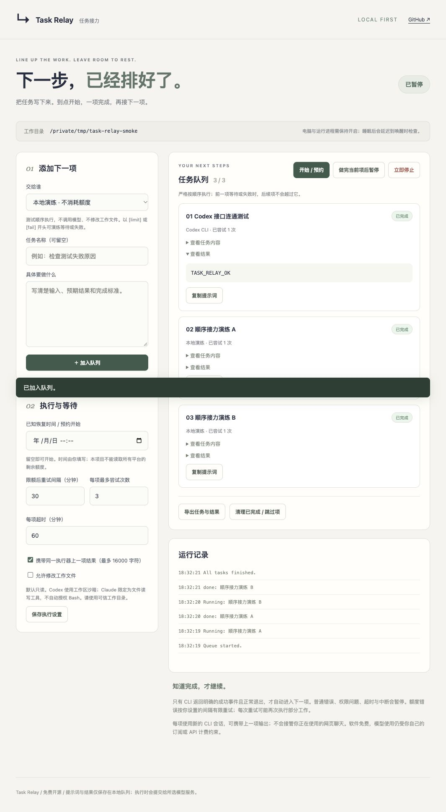

# Task Relay · 任务接力

**Queue the next steps. Let the runner hand them off, one at a time.**

先把下一步写好，再去休息。Task Relay 是免费的本地任务面板：预约开始时间，将任务依次交给 **Codex CLI / Claude Code**，在明确完成后接下一项；遇到额度限制就按设置等待，遇到其他失败就暂停。

[互动演示（不调用 AI）](https://608tt.github.io/task-relay/) · [下载源码 ZIP](https://github.com/608tt/task-relay/archive/refs/heads/main.zip) · [验证记录](docs/validation.md) · [English](#english)



## 为什么是本地面板

任务真正执行在你的电脑上，用的是已登录的官方 CLI；本项目不读取登录 Cookie，不存 API 密钥，也不依赖网页“发送按钮”的位置。服务器只监听 `127.0.0.1`，通过每次启动生成的本地访问令牌保护操作。

| 执行方式 | 自动接力 | 当前验证 |
| --- | --- | --- |
| Codex CLI | 支持，逐项调用 `codex exec --json` | macOS 官方 CLI 实际返回 `TASK_RELAY_OK`，成功识别完成 |
| Claude Code | 已实现 `claude -p --output-format stream-json` 适配 | 协议和子进程夹具已测；尚未做真实账号测试 |
| ChatGPT / 其他聊天网页 | 手动复制、手动确认完成 | 不自动点击或声称读取网页额度 |
| 本地演练 | 模拟成功、限额或失败 | 不消耗模型额度、不改工作文件 |

**不是绕过限额，也不能保证用满某个“五小时窗口”。** 平台的恢复时间、周额度、计划差异由平台决定。本项目允许填写已知恢复时间，并对明确识别到的额度错误做有限重试。软件免费，AI 用量仍按你自己的 CLI 登录方式、订阅或 API 计费。

<a id="quick-start"></a>
## 快速开始

需要 **Node.js 22+**。无需 `npm install`，没有 npm 依赖。

```sh
git clone https://github.com/608tt/task-relay.git
cd task-relay
node src/cli.js --workspace /absolute/path/to/your/project
```

不会 Git 也可以：下载上方 ZIP、解压，在项目文件夹打开终端运行同一条 `node src/cli.js ...` 命令。将 `/absolute/path/to/your/project` 换成你希望 AI 处理的可信项目文件夹；也可以省略 `--workspace`，使用当前文件夹。

1. 打开终端打印的**完整本地链接**。令牌放在 URL 片段中，页面读取后会从地址栏移除。
2. 先选择「本地演练」，添加两项任务，点「开始 / 预约」。确认顺序和停止按钮符合预期。
3. 安装并登录 [Codex CLI](https://developers.openai.com/codex/cli/) 或 [Claude Code](https://code.claude.com/docs/en/quickstart)。网页端登录不一定等于 CLI 已登录。
4. 添加真实任务。需要改文件时，先暂停队列，再勾选「允许修改工作文件」并保存。
5. 若知道额度恢复时间，填写预约时间。保持这个终端进程运行，并确保电脑不会睡眠。

关闭浏览器标签页不会停止本地执行；关闭进程会停止调度。`Ctrl+C` 请求中止当前 CLI，保留状态。电脑睡眠、断网或退出程序后不能保证按原时间执行。macOS/Linux 是首发目标；Windows 原生进程树停止尚未实机验证，建议 WSL。

## 队列规则

- **严格顺序**：第一项等待额度时，第二项不会偷偷先跑。
- **完成检测**：Codex `turn.completed` / Claude 成功 `result` + 进程退出码 0。没有完成事件，哪怕退出码为 0，也不算成功。CLI 完成不保证任务质量，仍需核查产物。
- **有限重试**：只从错误事件识别额度错误。默认间隔 30 分钟，每项最多 3 次尝试。普通文本提到“rate limit”不会触发重试。
- **停止与恢复**：普通失败、超时、权限拒绝或中断会停下。重启总是暂停，运行中的任务改为“已中断”，由你检查后重新排队。
- **上下文**：每项启动新 CLI 会话，可携带同一执行器上一项的最终输出（最多 16000 字符）。不会续接你正在使用的桌面聊天，不等于完整历史迁移。
- **只读默认**：Codex 使用只读沙箱；开启写入后使用 `workspace-write`。Claude 只允许 Read/Glob/Grep，开启写入增加 Edit/Write；不自动授予 Bash 或跳过权限检查。
- **数据留本地**：队列、结果和有限运行记录放在工作目录的 `.task-relay/queue.json`。执行提示词及可选上一步结果会发给你选择的模型服务。

额度报错可能发生在任务已经做了一部分之后；重试会重新提交本项，因此优先安排可重复执行的任务。付款、发信、生产部署等有外部副作用的任务应保留人工完成步骤。自动队列本身不能证明这些步骤可以安全重复。

## 日常操作

「做完当前项后暂停」不终止正在运行的任务；「立即停止」发送终止信号，并将部分结果保留为待检查。失败后可“已检查，重新排队”，或跳过。导出 JSON 可以备份任务和结果；目前不提供任意队列文件的网页导入。

状态写入使用原子替换，工作目录锁避免两个面板同时调度同一队列。若程序异常退出留下锁，先检查是否仍有 CLI 子进程运行，再执行：

```sh
node src/cli.js --workspace /absolute/path/to/project --recover-lock
```

这只会移除进程已不存在的旧锁，不会自动重跑中断项。其他问题见 [运行说明](docs/operations.md)。

## 开发与检查

```sh
npm test
npm run build
npm run demo
```

24 个测试覆盖顺序调度、重复启动、限额等待、停止、恢复、协议解析、命令注入边界和 HTTP 接口鉴权。`dist/` 为纯前端互动演示；演示不连接本地执行器。真实面板用 `npm start` / `node src/cli.js`。

## English

Task Relay is a local sequential task queue for Codex CLI and Claude Code. Schedule a start, enqueue prompts, wait for a confirmed completion event, then dispatch the next task. Known rate-limit failures get bounded retries; other failures pause the queue. It uses official CLI interfaces rather than scraping chat websites.

Requires Node.js 22+, plus a separately installed and authenticated CLI for real runs. No npm install is needed. Run `node src/cli.js --workspace /path/to/project` and open the private localhost URL printed in the terminal. Keep the process and machine awake. Default execution is read-only.

Each task starts a fresh CLI session; optional prior-result context is bounded and is not full conversation history. ChatGPT web is a manual handoff option. The hosted demo is a simulation. The software is free; provider usage and billing remain yours. See [validation](docs/validation.md), [architecture](docs/architecture.md), and [security](SECURITY.md).

MIT © 608tt. Independent project; not affiliated with OpenAI or Anthropic.
